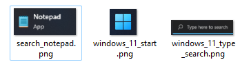

Sikulix Automation
------------------

**Sikulix Automation** is a simple RPA (robotic process automation) program which interacts with UI by clicking at specified elements on a screen and typing texts.

This program is written in Java and is using [SikuliX](http://www.sikulix.com/) library.

Program is reading configuration from ``config.json`` file by default.

You may specify alternate configuration file as first argument.

```
java -jar sikulix-automation.jar config.json
```

Command line options:

- ``-v``, ``--verbose`` - print more messages.
- ``-i``, ``--ignore`` - print step errors and continue the scenario instead of stopping it.

The same options can be set in ``config.json`` as ``"verbose": "true"`` and ``"ignore": "true"``. A value in the configuration file overrides the command line flag.

## Usage ##

Create JSON file ``config.json`` and execute program with ``java -jar`` command.

Scenario section defines base path for image files and array of steps to take.

### ``config.json`` ###

```json
{
  "verbose": "true",
  "scenario": {
    "name": "Hello",
    "steps": [
      {
        "print": "Hello, World!"
      },
      {
        "wait": "3",
        "print": "Goodbye, cruel world."
      },
      {
        "wait": "3"
      }
    ]
  }
}
```

Above example will simply print text with little delay.

```
Playing scenario Hello
Hello, World!
Goodbye, cruel world.
```

More complex example is on the way.

### ``config.json`` ###

```json
{
  "verbose": "true",
  "scenario": {
    "path": "C:/EXAMPLE/Scenario/",
    "steps": [
      {
        "click": "windows_11_start.png"
      },
      {
        "mouse": "RIGHT"
      },
      {
        "wait": "1.5"
      },
      {
        "click": "windows_11_type_search.png"
      },
      {
        "wait": "1.5"
      },
      {
        "type": "notepad"
      },
      {
        "wait": "1.5"
      },
      {
        "click": "search_notepad.png"
      },
      {
        "wait": "1.5"
      },
      {
        "message": "Hello, World"
      },
      {}
    ]
  }
}
```

Alternatively scenario file can be defined in separate ``scenario.json`` file.

### ``config.json`` ###

```json
{
  "play": "scenario.json"
}
```

### ``scenario.json`` ###

```json
{
  "scenario": {
    "steps": [
      {
        "print": "Hello, World."
      }
    ]
  }
}
```

The same scenario can be written in script file.

### ``scenario.script`` ###

```
PRINT Hello, World.
```

Scenario file can be set without file extension, program will try to find valid json or script file.

### ``config.json`` ###

```json
{
  "play": "scenario"
}
```

Images used to recognize UI elements to click in should be located in current working directory or specified by ``path`` in ``scenario`` section.



Every step may contain one or more elements from the list below.

 - label
 - path
 - delay
 - wait
 - similarity
 - print
 - mouse
 - find
 - click
 - popup
 - type
 - press
 - message
 - execute
 - when
 - then
 - jump
 - pause

### label ###

Mark location with name.

```json
{
  "label": "1000"
}
```

### path ###

Set path for images.

```json
{
  "path": "images"
}
```

### delay ###

Set delay for each step.

```json
{
  "delay": "3.0"
}
```

### wait ###

Set wait time when finding images.

```json
{
  "wait": "1.5"
}
```

### similarity ###

Set minimum similarity level.

```json
{
  "similarity": "0.7"
}
```

### click ###

Click inside UI element specified by image.

```json
{
  "click": "windows_start.png"
}
```

### popup ###

Perform right click on UI element specified by image.

```json
{
  "popup": "tray_battery.png"
}
```

### wait ###

Wait for specified time in seconds.

```json
{
  "wait": "1.5"
}
```

### type ###

Type text.

```json
{
  "type": "notepad"
}
```

### press ###

Press a key, optionally with modifier keys held. Each element is exactly one key press.

```json
{
  "press": "Alt+F4"
}
```

A value may also be an array to press several keys in order.

```json
{
  "press": ["Ctrl+Alt+G", "X"]
}
```

Modifiers can be written as symbols before the key or as names joined with ``+``.

| Symbol | Name      | Modifier |
|--------|-----------|----------|
| ``!``  | ``shift`` | Shift    |
| ``@``  | ``alt``   | Alt      |
| ``^``  | ``ctrl``  | Ctrl     |
| ``$``  | ``win``   | Win      |

Names are case-insensitive: ``Alt+A``, ``alt+a`` and ``ALT+A`` all press A while holding Alt. Symbol order does not matter: ``^!X`` and ``!^X`` both press X while holding Ctrl and Shift. The two forms may be combined, for example ``Ctrl+$D``. Additional aliases are ``control`` for Ctrl and ``meta`` or ``cmd`` for Win.

A single character presses that key. A longer value must be one of the named keys: ``F1``-``F15``, ``ENTER``, ``TAB``, ``ESC``, ``BACKSPACE``, ``SPACE``, ``UP``, ``DOWN``, ``LEFT``, ``RIGHT``, ``PAGE_UP``, ``PAGE_DOWN``, ``DELETE``, ``INSERT``, ``HOME``, ``END``, ``CAPS_LOCK``, ``NUM_LOCK``, ``SCROLL_LOCK``, ``PRINTSCREEN``, ``PAUSE``, ``CONTEXT``, ``ADD``, ``MINUS``, ``MULTIPLY``, ``DIVIDE``, ``DECIMAL``, ``SEPARATOR``, ``NEXT``, ``ALT``, ``CTRL``, ``SHIFT``, ``WIN``.

An unknown key name or malformed element fails the step. Use ``--ignore`` to print the error and continue the scenario.

In a script file keys are written as one or more values on a ``PRESS`` line, plain or double-quoted.

```
PRESS @F4 N
PRESS "Alt+F4"
PRESS " "
```

### mouse ###

Click down and up mouse button. Possible values are: "LEFT", "RIGHT", "MIDDLE".

```json
{
  "mouse": "RIGHT"
}
```

### message ###

Display message dialog.

```json
{
  "message": "Hello, World."
}
```

### print ###

Print text to standard output.

```json
{
  "print": "Hello, World."
}
```

## Scripting ##

Instead of using scenario in JSON it is possible to create script file and point to it ore more than one in ``config.json``.

```json
{
  "play": "scenario"
}
```

### ``scenario.script``

```
DELAY 0.5
LABEL 10
PATH C:/EXAMPLE/Scenario/
CLICK windows_11_start.png
MOUSE RIGHT
WAIT 0.5
MOUSE UP
WAIT 1.5
CLICK windows_11_type_search.png
WAIT 1.5
TYPE notepad
WAIT 1.5
CLICK search_notepad.png
WAIT 1.5
MESSAGE "Hello, World"
JUMP 10
```

## Build ##

Use [Apache Maven](https://maven.apache.org/) to build project.

```
mvn -T 1C package
```

## Project Rules ##

- Agents must follow [`docs/GUIDELINES.md`](docs/GUIDELINES.md) as the index of project rules and active documentation.
- People may browse the [docs directory](docs/) for project documentation.
